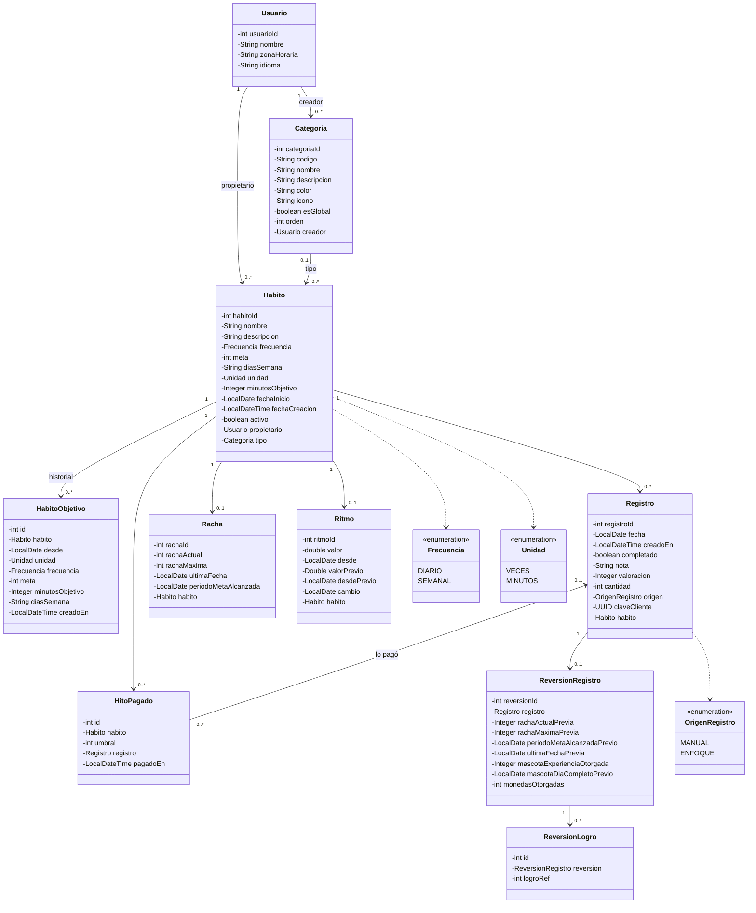
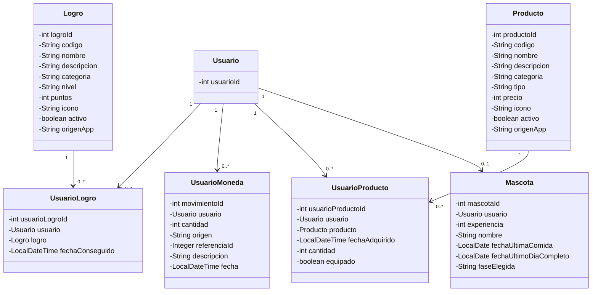
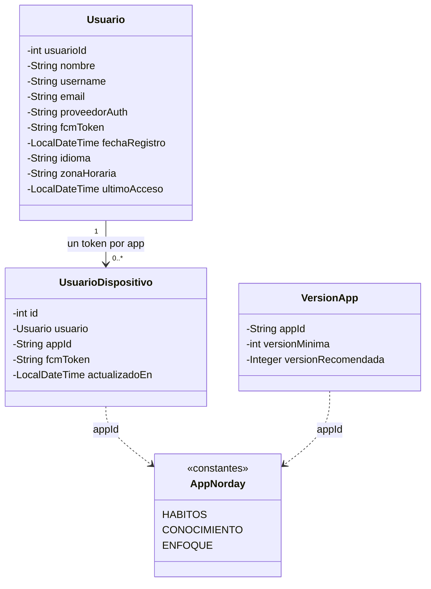
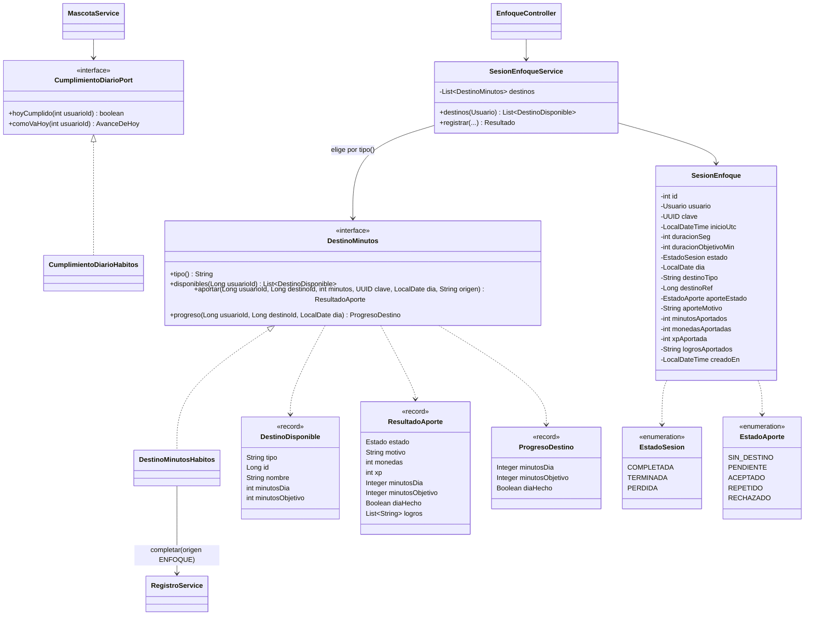
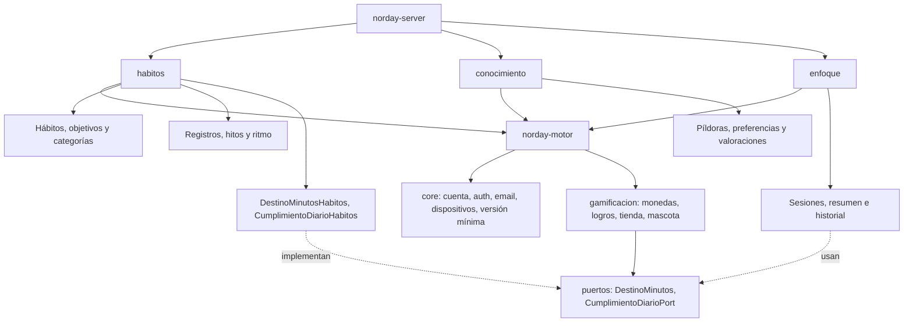
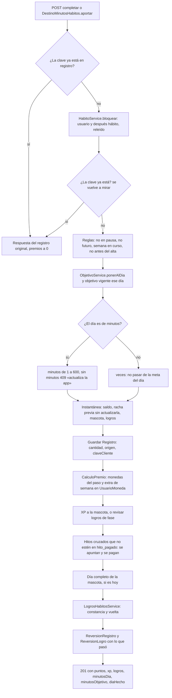
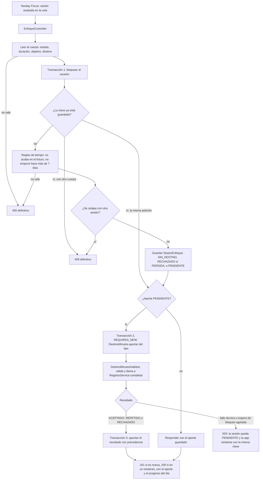
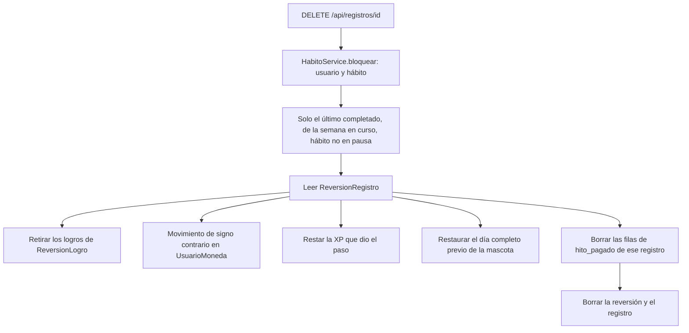

# Norday — Diagramas UML de clases y flujos (backend)

*Última actualización: noviembre de 2026*

Los diagramas se separan por responsabilidad para mantener la legibilidad:
**Núcleo de hábitos**, **Gamificación**, **Cuenta y dispositivos**,
**Norday Focus y los puertos del motor**, la **arquitectura de módulos** y los
**flujos** de un completado, de una sesión de Focus y de deshacer.

> Los diagramas representan clases que existen en el código de `wip-enfoque`.
> No incluyen estructuras futuras ni clases retiradas. Los atributos son los
> campos de cada entidad; se omiten algunos que no aportan a la lectura
> (UTM, contraseña, recordatorio).

---

## Dominio: Núcleo de hábitos (`habitos`)

- **`Habito` guarda una copia del objetivo vigente hoy** (`frecuencia`,
  `meta`, `diasSemana`, `unidad`, `minutosObjetivo`); el historial completo
  está en `HabitoObjetivo`, una fila por versión, vigente desde `desde`
  hasta la víspera de la siguiente. Puede haber como mucho una versión
  futura: el cambio programado. Cada día se juzga con la versión vigente ese
  día. Un hábito sin versiones se juzga con la copia de `Habito`.
- **`Registro.cantidad`** es lo que aporta al día: los minutos en un hábito
  de minutos, 1 en uno de veces. `origen` dice si vino del panel (`MANUAL`)
  o de una sesión de Norday Focus (`ENFOQUE`). `claveCliente` es la clave del
  reintento: única en la tabla, nunca sale en el JSON. `creadoEn` es el
  instante en que se marcó (UTC); `fecha`, el día al que corresponde.
- **`HitoPagado`** es el libro de hitos (3, 7, 30, 100 y 365 días hechos):
  una fila por hábito y umbral, para que un hito no se pague dos veces
  aunque los días hechos bajen y vuelvan a subir. Apunta al registro que lo
  pagó, y deshacer ese registro borra la fila.
- **`Ritmo`** no se guarda al día: es un ancla (`valor` desde `desde`, más el
  ancla anterior y la fecha del último cambio) que `RitmoService` pone al
  día repasando los registros al leer. Completar y deshacer no lo escriben;
  el ancla se mueve al cambiar el objetivo y con las pausas.
- **`Racha`** sigue en el modelo, pero el completado ya no la actualiza
  (apagada el 21-oct-2026): solo se guarda su estado en la reversión para
  que deshacer lo restaure.

---

## Dominio: Gamificación (`norday-motor`, `com.norday.gamificacion`)

- `origenApp` distingue el catálogo de cada app: `null` es del motor, y los
  logros y productos de hábitos (incluida la `PAUSA_HABITO`) llevan
  `habitos`.
- `UsuarioMoneda` es un libro de sólo añadir: el saldo es la suma de los
  movimientos, y deshacer compensa con un movimiento de signo contrario.
- La mascota **no guarda nivel ni fase**: el nivel sale de `experiencia` y la
  fase del nivel (`MascotaService`); `faseElegida` es solo la que el usuario
  ha elegido ver. El modelo no incluye `PerfilGamificacion`, retirado.

---

## Cuenta y dispositivos (`norday-motor`, `com.norday.core`)

- **`usuario_dispositivo`** guarda un token de FCM por usuario y app
  (restricción única `usuario_ref, app_id`). Lo escribe
  `DispositivoService` con la app de la cabecera `X-Norday-App` (sin
  cabecera, `habitos`), y todo envío push pide el token de su app.
- **`Usuario.fcmToken`** es columna de transición: se sigue escribiendo con el
  token de `habitos` para poder volver al jar anterior a V24.
- **`VersionApp`** es la versión mínima (versionCode) de cada app y, desde
  V33, la recomendada (nula = sin aviso, no obliga a nada); las lee
  `GET /api/version/{appId}`, público, que devuelve
  `{"versionMinima": n, "versionRecomendada": n | null}`.

---

## Norday Focus (`enfoque`) y los puertos del motor

- **Los puertos viven en el motor** (`gamificacion.service`, y los records en
  `gamificacion.model`) y los implementa el dominio que sabe responder:
  `DestinoMinutosHabitos` y `CumplimientoDiarioHabitos`, en `habitos`.
  `DestinoMinutosHabitos` es el destino de tipo `habito`.
  `enfoque` no conoce los hábitos ni `habitos` conoce las sesiones: Spring
  le da a `SesionEnfoqueService` todos los destinos como
  `List<DestinoMinutos>`, y elige por `tipo()`.
- **`destinoRef` no tiene FK**: es opaco para `enfoque`, y borrar el hábito no
  borra la sesión.
- **La sesión guarda lo que pagó el destino** (`monedasAportadas`,
  `xpAportada`, `logrosAportados`) para que un reintento devuelva el
  resultado original sin volver a llamar a `aportar`.
- `RegistroService` y `MascotaService` aparecen aquí solo como extremos de
  las dependencias; sus detalles, en los flujos de abajo y en 03.

---

## Arquitectura de módulos del backend

`norday-server` es el único ejecutable y cuelga de los tres dominios; cada
dominio cuelga del motor y ninguno conoce a los otros (Maven lo impone: no se
declaran entre sí). Cuando un dominio necesita algo de otro, el motor declara
un puerto y el otro lo implementa.

---

## Flujo de un completado (`RegistroService.completar`)

Lo usan el panel de la app (`POST /api/registros/completar/{habitoId}`) y
Norday Focus, a través de `DestinoMinutosHabitos.aportar`. Todo va en una
transacción.

- **La racha no se toca ni se guarda**: la reversión lleva sus cuatro campos
  a `null`.
- **El ritmo no se escribe**: `RitmoService` lo calcula al leer (Hoy,
  detalle) desde los registros.
- **El libro de hitos** decide qué hitos se pagan: los umbrales cruzados en
  este paso que no tengan ya fila en `hito_pagado`.
- Todo lo que el completado escribe en el saldo o en los logros se mide como
  «después − antes» con el usuario bloqueado, y queda en la reversión.

---

## Flujo de una sesión de Norday Focus (`POST /api/enfoque/sesiones`)

`SesionEnfoqueService.registrar` no es `@Transactional`: son tres
transacciones, para que un fallo al llevar los minutos no se lleve por
delante la sesión.

- **Enfoque no paga nada propio**: monedas, XP y logros los paga el hábito,
  con sus reglas, igual que el panel de minutos.
- **La clave de la sesión es la clave del registro**: un reintento no suma ni
  paga dos veces, ni en `sesion_enfoque` ni en `registro`.
- **El contrato de reintento**: 5xx o sin respuesta, reintentar con el mismo
  cuerpo; 400 y 409, definitivos. La cola de Focus deja también en la cola
  otros 4xx (401, 404) y descarta las sesiones de más de 7 días.

---

## Deshacer un completado

Todo efecto nuevo de un completado tiene que quedar en la reversión. Deshacer
un registro que vino de una sesión de Focus no toca la sesión: sus
`minutosAportados` se quedan (limitación conocida).

---

## Notas

- `RachaService` aplica una estrategia de **rotura perezosa**: la racha se
  normaliza al leerla, no con un proceso que resetee rachas a una hora fija.
  Y desde el 21-oct-2026 el completado ya no la actualiza.
- **`NotificadorRachaEnPeligro` está desactivado**: su `@Scheduled` está
  comentado desde el rediseño de rachas (B5) y el barrido no corre. El único
  barrido programado de `habitos` es `NotificacionScheduler` (recordatorios,
  cada 5 minutos).
- El modelo de gamificación es compartido por el ecosistema; los eventos que
  generan logros de hábitos pertenecen al módulo `habitos`.
- No se representan aquí clases retiradas ni estructuras marcadas únicamente
  como futuras.
